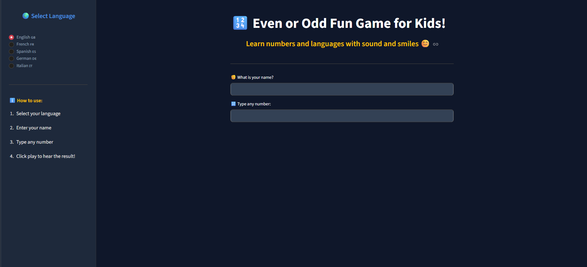

# Even or Odd Learning Game

[](https://evennumberapp.streamlit.app/) [](https://xyrusportfolio.netlify.app/)

> A child-friendly Streamlit game for recognizing even and odd whole numbers, with selectable interface languages and text-to-speech output.

**Live demo:** https://evennumberapp.streamlit.app/  
**Project documentation and source:** https://github.com/ebukaxyrus/evennumberapp  
**Maintainer:** Dimakunne Chukwuebuka Francis

## At a glance

| Area | Details |
| --- | --- |
| Category | Mathematics Education / Audio |
| Application framework | Streamlit |
| Entry point | `evennumberapp.py` |
| Deployment | [Open live application](https://evennumberapp.streamlit.app/) |

## Application preview

[**Launch the live interactive application**](https://evennumberapp.streamlit.app/) to view its actual interface.



## The problem and approach

A child-friendly Streamlit game for recognizing even and odd whole numbers, with selectable interface languages and text-to-speech output.

The underlying rule is deterministic integer parity, not predictive machine learning. Localized messages are defined in a hard-coded language dictionary and gTTS is invoked when the user requests audio.

## Features

- Choose an interface language using the sidebar.
- Enter the learner's name and a whole number.
- Determine parity by checking `number % 2 == 0`.
- Show a personalized explanation and examples.
- Generate and play a spoken result using gTTS.
- Offer the generated speech file for download.

## Technology stack

- Python
- Streamlit
- gTTS

## Repository structure

- `evennumberapp.py` — Streamlit interface, localized strings, parity calculation and audio generation.
- `requirements.txt` — dependencies.

## Run locally

Prerequisites: Python 3.10+ is a reasonable starting environment, but no fixed compatibility matrix has been independently tested. Check the dependency versions actually available for your environment.

```bash
git clone https://github.com/ebukaxyrus/evennumberapp.git
cd evennumberapp
python -m venv .venv
```

Activate the environment:

```bash
# macOS or Linux
source .venv/bin/activate
# Windows PowerShell
# .venv\\Scripts\\Activate.ps1
```

Install packages and start the app:

```bash
python -m pip install -r requirements.txt
streamlit run evennumberapp.py
```

Run from the repository root so the app can find its local data/assets. Where the app uses text-to-speech or browser capabilities, allow the relevant permissions.

## How to use

1. Select a language from the sidebar (English, French, Spanish, German or Italian in the inspected source).
2. Enter a learner name and an integer.
3. Read whether the number is even or odd.
4. Click the voice button to hear the spoken result.

## Limitations and responsible use

- Some non-English phrases may need native-speaker review.
- gTTS requires network connectivity and a supported language.
- The source saves generated audio to `result.mp3`; concurrent deployments may require safer per-user temporary files.
- The application validates integer input but is not designed as a formal learning-outcome assessment.

## Quality and future improvements

- [ ] Test a clean installation and pin compatible dependency versions.
- [ ] Add real screenshots, alt text and demonstration media.
- [ ] Add automated tests for primary use cases and invalid input.
- [ ] Review accessibility, error handling and mobile usability.
- [ ] Verify datasets, licenses, user privacy, and live deployment behavior.

## Maintainer and links

**Dimakunne Chukwuebuka Francis**  
Head of Data & Artificial Intelligence, Schoolville ICT Hub  
Founder, XY AI Solution

- [Professional portfolio](https://xyrusportfolio.netlify.app/)
- [GitHub profile](https://github.com/ebukaxyrus)
- [XY AI Solution](https://xyaisolution.online/)

**Documentation scope:** Written from repository source inspection; successful clean-environment installation and end-to-end live application behavior have not been independently verified.
